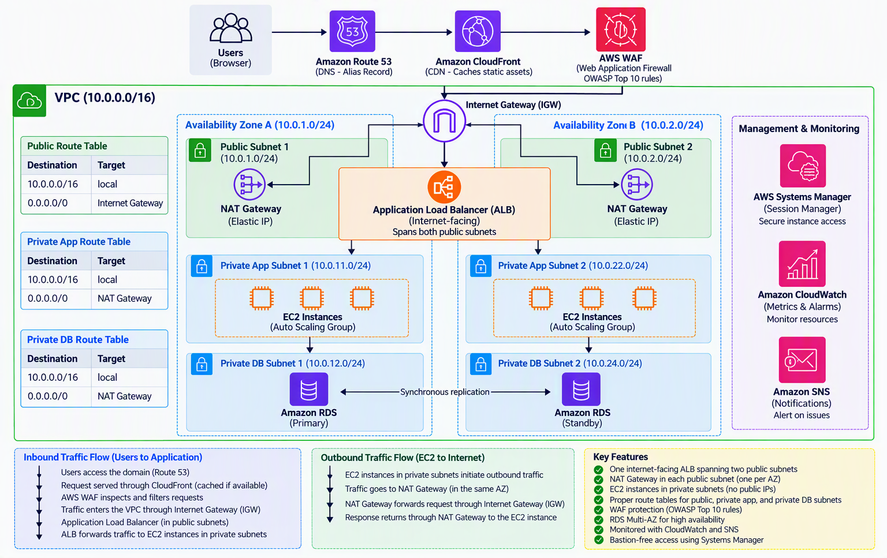

# Scalable Web Application with ALB and Auto Scaling

## Project Overview

This project demonstrates the design of a secure, highly available, and scalable web application on AWS.

The application runs on Amazon EC2 instances deployed in private application subnets across two Availability Zones. A single internet-facing Application Load Balancer (ALB) spans the two public subnets and distributes incoming traffic across healthy EC2 instances. The EC2 instances are managed by an Auto Scaling Group (ASG), which adjusts application capacity based on demand.

Amazon RDS Multi-AZ provides a highly available relational database across private database subnets. Amazon CloudFront improves content delivery by caching content closer to users, while AWS WAF provides protection against common web attacks. Amazon Route 53 provides DNS services for the application.

The architecture also uses an Internet Gateway to provide internet connectivity to the VPC and NAT Gateways to allow EC2 instances in private subnets to initiate outbound connections without being directly exposed to the internet.

Security Groups provide resource-level traffic control, while Network Access Control Lists (NACLs) can provide an additional layer of subnet-level protection.

The overall goal is to build a production-style AWS architecture that remains available, secure, and scalable during changes in traffic and infrastructure failures.

---

## Problem Statement

A company wants to host a web application on AWS that can support changing levels of traffic while remaining highly available and secure.

The solution should:

- Avoid a single point of failure.
- Automatically scale when application demand changes.
- Distribute traffic across multiple application servers.
- Keep EC2 application servers and databases in private subnets.
- Provide controlled outbound internet access for private EC2 instances.
- Provide a highly available relational database.
- Protect the web application from common attacks.
- Provide monitoring and notifications.
- Allow administrators to securely manage EC2 instances.

---

## Objectives

The objectives of this project are to:

- Design a VPC across two Availability Zones.
- Deploy public, private application, and private database subnets.
- Configure an Internet Gateway for VPC internet connectivity.
- Configure NAT Gateways for outbound internet access from private application subnets.
- Deploy EC2 instances inside private application subnets.
- Distribute application traffic using an Application Load Balancer.
- Automatically scale EC2 instances using an Auto Scaling Group.
- Deploy an Amazon RDS Multi-AZ database.
- Improve application security using AWS WAF, Security Groups, and Network ACLs.
- Improve content delivery using Amazon CloudFront.
- Configure DNS using Amazon Route 53.
- Control access using AWS Identity and Access Management (IAM).
- Monitor the environment using Amazon CloudWatch.
- Send alerts using Amazon SNS.
- Provide secure EC2 access using AWS Systems Manager Session Manager.

---

## Solution Architecture

The main inbound application traffic follows this path:

**Users → Route 53 → CloudFront → AWS WAF → Internet Gateway → Application Load Balancer → EC2 Auto Scaling Group → Amazon RDS**

The Application Load Balancer is internet-facing and spans the two public subnets. The EC2 application instances are deployed across two private application subnets.

Amazon RDS is deployed using Multi-AZ across private database subnets.

For outbound internet connectivity, EC2 instances in the private application subnets use NAT Gateways located in the public subnets:

**EC2 → NAT Gateway → Internet Gateway → Internet**

The NAT Gateways are used for outbound connectivity and are not part of the inbound user traffic path.

### Architecture Diagram



---

## AWS Services Used

| Service | Purpose |
|---|---|
| Amazon VPC | Provides an isolated network for the application |
| Internet Gateway | Provides internet connectivity for resources using public routes |
| Public Subnets | Contain the internet-facing ALB and NAT Gateways |
| Private App Subnets | Contain EC2 application instances |
| Private DB Subnets | Contain the Amazon RDS database |
| Route Tables | Control how traffic is routed within and outside the VPC |
| Network ACLs | Provide subnet-level network traffic control |
| Security Groups | Provide resource-level traffic control |
| NAT Gateway | Provides outbound internet connectivity for EC2 instances in private subnets |
| Amazon EC2 | Hosts the web application |
| Auto Scaling Group | Automatically adjusts EC2 capacity |
| Application Load Balancer | Distributes incoming traffic across healthy EC2 instances |
| AWS WAF | Protects the application from common web attacks |
| Amazon CloudFront | Caches content and improves content delivery |
| Amazon RDS Multi-AZ | Provides a highly available relational database |
| Amazon Route 53 | Provides DNS services |
| AWS IAM | Controls access to AWS resources |
| AWS Systems Manager | Provides secure administrative access to EC2 instances |
| Amazon CloudWatch | Provides monitoring, metrics, dashboards, and alarms |
| Amazon SNS | Sends notifications when alarms are triggered |

---

## Architecture Components

### 1. Amazon VPC

The application infrastructure is deployed inside an Amazon Virtual Private Cloud (VPC).

The VPC provides network isolation and allows resources to be separated into public, private application, and private database subnets.

The architecture spans two Availability Zones to improve availability and reduce dependency on a single Availability Zone.

---

### 2. Internet Gateway

An Internet Gateway is attached to the VPC to provide connectivity between the VPC and the internet.

The public subnet route tables contain a default route that directs internet-bound traffic to the Internet Gateway.

```text
0.0.0.0/0 → Internet Gateway
```

The internet-facing Application Load Balancer and NAT Gateways use the public subnet infrastructure.

---

### 3. Public Subnets

A public subnet is deployed in each Availability Zone.

The public subnets contain:

- Application Load Balancer connectivity
- NAT Gateways

The public subnet route tables have a route to the Internet Gateway.

The Application Load Balancer spans both public subnets, allowing it to distribute incoming requests to EC2 instances in both Availability Zones.

---

### 4. Private Application Subnets

The EC2 instances are deployed in private application subnets across the two Availability Zones.

The EC2 instances do not require public IP addresses because users do not connect directly to them.

Incoming application requests reach the EC2 instances through the Application Load Balancer.

For outbound internet access, the private application subnet route tables direct internet-bound traffic to a NAT Gateway.

```text
0.0.0.0/0 → NAT Gateway
```

---

### 5. NAT Gateways

A NAT Gateway is deployed in each public subnet.

The NAT Gateways allow EC2 instances in private application subnets to initiate outbound internet connections without making those EC2 instances publicly accessible.

For example, an EC2 instance might need outbound connectivity to download software updates or communicate with an external API.

The outbound path is:

```text
EC2 Instance
      ↓
NAT Gateway
      ↓
Internet Gateway
      ↓
Internet
```

The NAT Gateway is not used for inbound user traffic.

---

### 6. Application Load Balancer

A single internet-facing Application Load Balancer spans the public subnets in both Availability Zones.

The ALB receives incoming application requests and forwards them to healthy EC2 instances registered in its target group.

The ALB uses health checks to determine which EC2 instances are healthy and available to receive traffic.

This prevents the application from depending on a single EC2 instance.

---

### 7. Amazon EC2

Amazon EC2 instances host the web application.

The EC2 instances are deployed inside private application subnets across two Availability Zones.

Users do not communicate directly with individual EC2 instances. Application requests pass through the Application Load Balancer.

---

### 8. Auto Scaling Group

The EC2 instances are managed by an Auto Scaling Group.

Auto Scaling allows application capacity to adjust according to workload demand.

When demand increases, additional EC2 instances can be launched.

When demand decreases, unnecessary EC2 instances can be terminated.

The Auto Scaling Group spans the two private application subnets, helping maintain application availability across both Availability Zones.

---

### 9. Amazon RDS Multi-AZ

Amazon RDS provides the relational database for the application.

The database is deployed in private database subnets and is not directly accessible from the internet.

The Multi-AZ configuration maintains database availability by providing a primary database instance and a standby instance in another Availability Zone.

If the primary database becomes unavailable, the Multi-AZ configuration supports database failover.

---

### 10. Amazon CloudFront

Amazon CloudFront provides content delivery for the application.

CloudFront can cache content closer to users, reducing latency and decreasing the amount of traffic that needs to reach the application infrastructure.

---

### 11. AWS WAF

AWS WAF provides an additional security layer for the web application.

WAF rules can inspect incoming web requests and help protect the application against common web attacks.

---

### 12. Amazon Route 53

Amazon Route 53 provides DNS services for the application.

When users access the application's domain name, Route 53 resolves the domain and directs requests toward the application entry point.

---

### 13. AWS Identity and Access Management

AWS Identity and Access Management (IAM) policies can be used to grant AWS services and administrators only the permissions required to perform their tasks.

---

### 14. AWS Systems Manager

AWS Systems Manager Session Manager provides secure administrative access to EC2 instancesstances without exposing them directly to the internet or maintaining a traditional bastion host.

---

### 15. Amazon CloudWatch

Amazon CloudWatch provides monitoring for the application and its AWS infrastructure.

CloudWatch can monitor resources such as:

- Amazon EC2
- Application Load Balancer
- Auto Scaling Group
- Amazon RDS

CloudWatch dashboards provide visibility into application and infrastructure health.

CloudWatch alarms can identify configured conditions that require attention.

---

### 16. Amazon SNS

Amazon Simple Notification Service (SNS) provides notifications.

CloudWatch alarms can trigger SNS notifications when configured conditions occur, allowing administrators to receive alerts about application or infrastructure issues.

---

## Route Tables

### Public Subnet Route Table

The public subnets use the Internet Gateway as the destination for internet-bound traffic.

| Destination | Target |
|---|---|
| VPC CIDR | Local |
| 0.0.0.0/0 | Internet Gateway |

### Private Application Subnet Route Table

Private application subnets use a NAT Gateway for outbound internet traffic.

| Destination | Target |
|---|---|
| VPC CIDR | Local |
| 0.0.0.0/0 | NAT Gateway |

The architecture uses a NAT Gateway in each Availability Zone so that private application resources can use a NAT Gateway in the corresponding Availability Zone.

---

## Traffic Flow

### Inbound Application Traffic

A normal user request follows this path:

1. A user accesses the web application's domain.
2. Amazon Route 53 resolves the application's domain.
3. The request is delivered through Amazon CloudFront.
4. AWS WAF checks the request against configured security rules.
5. The request reaches the internet-facing Application Load Balancer.
6. The Application Load Balancer receives the request.
7. The ALB selects a healthy EC2 instance from its target group.
8. The EC2 instance processes the application request.
9. If database access is required, the EC2 application communicates with Amazon RDS.
10. The response is returned to the user.

### Outbound EC2 Traffic

When an EC2 instance in a private application subnet needs internet access:

1. The EC2 instance initiates the outbound request.
2. The private subnet route table directs the request to the NAT Gateway in the corresponding Availability Zone.
3. The NAT Gateway sends the traffic toward the Internet Gateway.
4. The traffic leaves the VPC for the external destination.
5. Response traffic returns through the established connection.

---

## High Availability

The architecture is designed to avoid dependency on a single EC2 instance or Availability Zone.

High availability is achieved through:

- Two Availability Zones.
- Public subnets in both Availability Zones.
- Private application subnets in both Availability Zones.
- Private database subnets in both Availability Zones.
- Multiple EC2 instances.
- Auto Scaling.
- Application Load Balancer health checks.
- NAT Gateways across both Availability Zones.
- Amazon RDS Multi-AZ.

If an EC2 instance becomes unhealthy, the Application Load Balancer stops routing new application requests to the unhealthy target.

The Auto Scaling Group maintains the configured application capacity across the private application subnets.

Amazon RDS Multi-AZ provides database redundancy across Availability Zones.

---

## Scalability

The main scaling mechanism in the architecture is the Auto Scaling Group.

Scaling policies can increase or decrease EC2 capacity according to application demand.

For example:

```text
Traffic increases
       ↓
Application load increases
       ↓
Auto Scaling adds EC2 capacity
       ↓
ALB distributes traffic across healthy instances
```

When demand decreases, Auto Scaling can reduce unnecessary EC2 capacity.

CloudFront also reduces the amount of traffic reaching the application infrastructure by serving cached content closer to users.

---

## Security

The architecture applies security at multiple layers.

### Network Security

EC2 instances and Amazon RDS are deployed inside private subnets, preventing them from being directly exposed to the internet.

Network ACLs (NACLs) can provide additional subnet-level protection by controlling inbound and outbound traffic for the public and private subnets.

### Security Groups

Security Groups provide resource-level traffic control. The ALB Security Group controls traffic reaching the load balancer, the EC2 Security Group restricts application traffic to the ALB, and the RDS Security Group restricts database access to the application layer.

Security Groups are stateful, while Network ACLs are stateless and operate at the subnet level. Both can be used together to provide layered network security.

### AWS WAF

AWS WAF inspects web requests and provides protection against configured web threats.

### Private Subnets

EC2 and database resources remain in private subnets and are not directly exposed to the internet.

### Administrative Access

AWS Systems Manager Session Manager provides secure administrative access to EC2 instances without requiring direct inbound administrative access from the internet.

### IAM

IAM roles and policies control permissions to AWS resources and services.

---

## Monitoring and Notifications

Amazon CloudWatch monitors the application infrastructure.

Important resources that can be monitored include:

- EC2 instances
- Application Load Balancer
- Auto Scaling Group
- Amazon RDS

CloudWatch dashboards provide visibility into infrastructure health and performance.

CloudWatch alarms can trigger Amazon SNS notifications when configured conditions are met.

The monitoring flow is:

```text
AWS Resources
      ↓
Amazon CloudWatch
      ↓
CloudWatch Alarm
      ↓
Amazon SNS
      ↓
Notification
```

---

## Conclusion

This project demonstrates how a web application can be deployed on AWS using a secure, highly available, and scalable architecture.

The Application Load Balancer distributes incoming application requests across EC2 instances running in private application subnets, while the Auto Scaling Group manages application capacity across two Availability Zones.

Amazon RDS Multi-AZ provides a highly available database layer in private database subnets. The Internet Gateway provides internet connectivity for resources using public routes, while NAT Gateways provide controlled outbound internet connectivity for EC2 instances located in private application subnets.

Security Groups control traffic at the resource level, while Network ACLs can provide additional subnet-level network protection.

CloudFront, AWS WAF, Route 53, IAM, Systems Manager, CloudWatch, and SNS provide supporting content delivery, security, DNS, access control, administration, monitoring, and notification capabilities.

Overall, the solution demonstrates the core AWS networking, compute, database, security, scalability, and high-availability concepts required to design a production-style web application architecture.

---

## Author

**Johnson Kalibbala**

AWS Solutions Architect Associate Graduation Project
